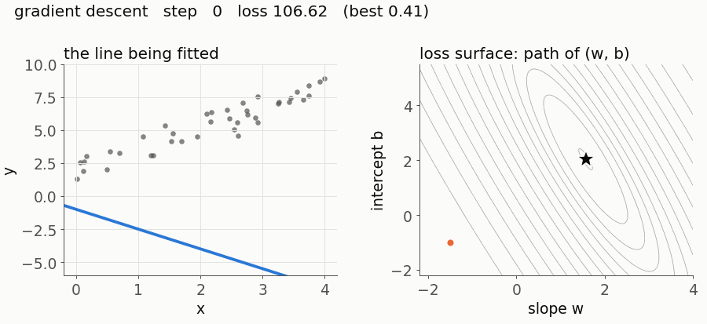

# 01 · Linear regression and gradient descent

Fit the straight line (or flat plane) that best predicts a number from other numbers, and learn gradient descent: the optimisation method used to train almost every model in this repository.



## Intuition

You have points and want a line through them. Any line is described by a slope `w` and an intercept `b`. For a given line, measure how wrong it is: for each point, take the vertical gap between the point and the line, square it, and average. That average is the *loss*. Every pair `(w, b)` has a loss, so the losses form a surface, shaped like a bowl. Gradient descent starts anywhere on the bowl, works out which direction is downhill (the *gradient* tells you), takes a small step that way, and repeats. Because the bowl has exactly one lowest point, small enough steps always reach it.

## The maths

**Setup.** We have $n$ examples. Example $i$ has a feature vector $\mathbf{x}_i \in \mathbb{R}^d$ (one number per feature) and a target $y_i \in \mathbb{R}$. Stack the feature vectors as the rows of a matrix $X \in \mathbb{R}^{n \times d}$.

**Model.** The prediction for example $i$ is a weighted sum of its features plus an intercept:

$$\hat{y}_i = \mathbf{x}_i^\top \mathbf{w} + b = w_1 x_{i1} + w_2 x_{i2} + \dots + w_d x_{id} + b.$$

For all examples at once, $\hat{\mathbf{y}} = X\mathbf{w} + b$, where $b$ is added to every entry.

**Loss.** Define the residual $e_i = \hat{y}_i - y_i$. The mean squared error is

$$L(\mathbf{w}, b) = \frac{1}{n}\sum_{i=1}^{n} e_i^2 = \frac{1}{n}\sum_{i=1}^{n} \left(\mathbf{x}_i^\top \mathbf{w} + b - y_i\right)^2.$$

**Gradient with respect to one weight.** Differentiate with respect to $w_j$. The sum and the constant $\tfrac{1}{n}$ pass straight through the derivative, so we only need the derivative of one squared term. By the chain rule, with outer function $u^2$ and inner function $u = e_i$:

$$\frac{\partial}{\partial w_j} e_i^2 = 2 e_i \cdot \frac{\partial e_i}{\partial w_j}.$$

In $e_i = w_1 x_{i1} + \dots + w_d x_{id} + b - y_i$, the only term containing $w_j$ is $w_j x_{ij}$, so $\partial e_i / \partial w_j = x_{ij}$. Therefore

$$\frac{\partial L}{\partial w_j} = \frac{2}{n}\sum_{i=1}^{n} e_i \, x_{ij}.$$

**All weights at once.** The sum $\sum_i e_i x_{ij}$ is the dot product of column $j$ of $X$ with the residual vector $\mathbf{e}$. Doing this for every $j$ is exactly the matrix product $X^\top \mathbf{e}$:

$$\nabla_{\mathbf{w}} L = \frac{2}{n} X^\top \mathbf{e}, \qquad \mathbf{e} = X\mathbf{w} + b - \mathbf{y}.$$

**Gradient with respect to the intercept.** The same argument with $\partial e_i / \partial b = 1$ gives

$$\frac{\partial L}{\partial b} = \frac{2}{n}\sum_{i=1}^{n} e_i.$$

**Gradient descent.** The gradient points uphill, so step the other way. With learning rate $\eta > 0$, repeat:

$$\mathbf{w} \leftarrow \mathbf{w} - \eta \, \nabla_{\mathbf{w}} L, \qquad b \leftarrow b - \eta \, \frac{\partial L}{\partial b}.$$

**The closed-form answer.** Absorb the intercept into the weights: append a column of ones to $X$ to get $A = [X \mid \mathbf{1}] \in \mathbb{R}^{n \times (d+1)}$ and let $\boldsymbol{\theta} = (\mathbf{w}, b)$. Then $\hat{\mathbf{y}} = A\boldsymbol{\theta}$, $L = \tfrac{1}{n}\lVert A\boldsymbol{\theta} - \mathbf{y}\rVert^2$, and by the result above $\nabla L = \tfrac{2}{n}A^\top(A\boldsymbol{\theta} - \mathbf{y})$. At the minimum the gradient is zero:

$$\frac{2}{n}A^\top(A\boldsymbol{\theta}^\star - \mathbf{y}) = \mathbf{0} \quad\Longrightarrow\quad A^\top A\,\boldsymbol{\theta}^\star = A^\top \mathbf{y}.$$

These are the *normal equations*. If $A^\top A$ is invertible (no feature is an exact linear combination of the others) there is exactly one solution.

**How large can the learning rate be?** The loss is quadratic in $\boldsymbol{\theta}$, so its matrix of second derivatives (the Hessian) is the constant $H = \tfrac{2}{n}A^\top A$. Using the normal equations, $\tfrac{2}{n}A^\top\mathbf{y} = H\boldsymbol{\theta}^\star$, so the gradient can be rewritten as

$$\nabla L(\boldsymbol{\theta}) = H\boldsymbol{\theta} - H\boldsymbol{\theta}^\star = H(\boldsymbol{\theta} - \boldsymbol{\theta}^\star).$$

Substitute into the update and subtract $\boldsymbol{\theta}^\star$ from both sides. The distance from the answer, $\boldsymbol{\delta}_k = \boldsymbol{\theta}_k - \boldsymbol{\theta}^\star$, evolves as

$$\boldsymbol{\delta}_{k+1} = (I - \eta H)\,\boldsymbol{\delta}_k.$$

$H$ is symmetric, so it has orthogonal eigenvectors with real eigenvalues $\lambda \ge 0$. Along an eigenvector, multiplying by $I - \eta H$ simply multiplies by the number $1 - \eta\lambda$. After $k$ steps that component of the error has been multiplied by $(1 - \eta\lambda)^k$, which shrinks to zero if and only if $|1 - \eta\lambda| < 1$, that is $0 < \eta < 2/\lambda$. This must hold for every eigenvalue, so

$$\text{gradient descent converges} \iff 0 < \eta < \frac{2}{\lambda_{\max}(H)}.$$

The slowest direction is the one with the smallest eigenvalue, whose error shrinks by $|1 - \eta\lambda_{\min}|$ per step. With $\eta$ near its limit this factor is about $1 - 2\lambda_{\min}/\lambda_{\max}$. The ratio $\kappa = \lambda_{\max}/\lambda_{\min}$ is the *condition number*. When $\kappa$ is large the bowl is a long, narrow valley: steps bounce across the narrow direction while creeping along the long one. That is the zig-zag in the animation.

## Code walkthrough

All line numbers refer to [`model.py`](model.py).

| Equation | Code | Lines |
|---|---|---|
| $L = \frac{1}{n}\sum_i (\hat{y}_i - y_i)^2$ | `np.mean((y_hat - y) ** 2)` | [14](model.py#L14) |
| $\mathbf{e} = X\mathbf{w} + b - \mathbf{y}$ | `residual = X @ w + b - y` | [20](model.py#L20) |
| $\nabla_{\mathbf{w}} L = \frac{2}{n}X^\top\mathbf{e}$ | `grad_w = (2 / n) * X.T @ residual` | [21](model.py#L21) |
| $\partial L/\partial b = \frac{2}{n}\sum_i e_i$ | `grad_b = (2 / n) * residual.sum()` | [22](model.py#L22) |
| $A = [X \mid \mathbf{1}]$ | `np.column_stack([X, np.ones(len(X))])` | [28](model.py#L28) |
| $A^\top A\,\boldsymbol{\theta}^\star = A^\top\mathbf{y}$ | `np.linalg.solve(A.T @ A, A.T @ y)` | [34](model.py#L34) |
| $H = \frac{2}{n}A^\top A$ | `H = (2 / len(X)) * A.T @ A` | [45](model.py#L45) |
| $\eta_{\max} = 2/\lambda_{\max}(H)$ | `2 / np.linalg.eigvalsh(H).max()` | [46](model.py#L46) |
| start at $\mathbf{w} = \mathbf{0}$ | `np.zeros(X.shape[1])` | [61](model.py#L61) |
| $\mathbf{w} \leftarrow \mathbf{w} - \eta\nabla_{\mathbf{w}}L$, $b \leftarrow b - \eta\,\partial L/\partial b$ | `w = w - self.learning_rate * grad_w` and the line after | [67-69](model.py#L67-L69) |

`eigvalsh` is used instead of `eigvals` because $H$ is symmetric: it is faster and guarantees real eigenvalues.

The tests in [`test_model.py`](test_model.py) check the closed form and gradient descent against scikit-learn (to `1e-10` and `1e-8`), the gradients against PyTorch autograd (to `1e-10`), and the learning-rate bound on both sides. Every example below is also run by the test suite, so its numbers stay correct.

## Where it breaks

Run these from inside this folder.

**1. A learning rate 1% too large diverges.** The bound $2/\lambda_{\max}$ is a cliff, not a guideline.

```python
import numpy as np
from model import LinearRegression, max_stable_learning_rate

rng = np.random.default_rng(0)
X = rng.normal(size=(100, 3))
y = X @ np.array([1.0, -2.0, 0.5]) + rng.normal(scale=0.1, size=100)

limit = max_stable_learning_rate(X)                               # about 0.806
ok = LinearRegression(learning_rate=0.99 * limit, n_iters=2000).fit(X, y)
bad = LinearRegression(learning_rate=1.01 * limit, n_iters=2000).fit(X, y)
print(ok.losses[-1], bad.losses[-1])                              # 0.0081  1.6e+34
assert ok.losses[-1] < 0.01 and bad.losses[-1] > 1e30
```

**2. Unscaled features: the loss looks finished, the weights are wrong.** House size in square metres (around 100) next to number of rooms (around 3) gives a condition number around 400,000. After 10,000 steps the loss is within 6% of optimal, which looks converged, but the rooms coefficient is 11% off and the intercept has the wrong sign. Standardising each feature (subtract its mean, divide by its standard deviation) brings the condition number close to 1 and gradient descent converges in a few dozen steps.

```python
import numpy as np
from model import LinearRegression, max_stable_learning_rate, mse, normal_equation

rng = np.random.default_rng(0)
size, rooms = rng.normal(100, 20, 200), rng.normal(3, 1, 200)
y = 0.5 * size + 10 * rooms + rng.normal(0, 5, 200)
X = np.column_stack([size, rooms])

w_best, b_best = normal_equation(X, y)
gd = LinearRegression(learning_rate=0.9 * max_stable_learning_rate(X), n_iters=10_000).fit(X, y)
print(gd.losses[-1] / mse(y, X @ w_best + b_best))   # 1.05: loss looks nearly done
print(gd.coef_, w_best)                              # [0.518 9.19] vs [0.517 10.30]
print(gd.intercept_, b_best)                         # 0.62 vs -2.52
assert gd.losses[-1] / mse(y, X @ w_best + b_best) < 1.06
assert abs(gd.coef_[1] - w_best[1]) > 1.0 and gd.intercept_ * b_best < 0

Xs = (X - X.mean(axis=0)) / X.std(axis=0)            # standardised
gd_s = LinearRegression(learning_rate=0.9 * max_stable_learning_rate(Xs), n_iters=50).fit(Xs, y)
ws, bs = normal_equation(Xs, y)
assert np.allclose(gd_s.coef_, ws, atol=1e-6) and abs(gd_s.intercept_ - bs) < 1e-6
```

**3. One bad point drags the whole line.** Squaring the residuals means a point 39 units away costs 1,521, so the fit gives up accuracy everywhere else to reduce that single cost.

```python
import numpy as np
from model import normal_equation

x = np.arange(20.0)
y = 2 * x + 1                    # a perfect line: slope 2, intercept 1
y[-1] = 0                        # one corrupted reading (should be 39)
w, b = normal_equation(x[:, None], y)
print(w, b)                      # [1.443] 4.343
assert abs(w[0] - 2) > 0.5
```

**4. Duplicated features: the closed form fails, gradient descent quietly picks one answer.** If one feature is an exact copy (or multiple) of another, $A^\top A$ is singular and there are infinitely many equally good weight vectors. `np.linalg.solve` raises an error. Gradient descent started from zero never fails: it converges to the solution with the smallest $\lVert\boldsymbol\theta\rVert$, which splits the weight equally between the copies. That is not a property of the data, so neither weight on its own means anything.

```python
import numpy as np
from model import LinearRegression, normal_equation

rng = np.random.default_rng(0)
x = rng.normal(size=100)
X = np.column_stack([x, x])                          # second feature is a copy
y = 3 * x + rng.normal(scale=0.1, size=100)

try:
    normal_equation(X, y)
    raise AssertionError("expected a singular matrix")
except np.linalg.LinAlgError as err:
    print(err)                                       # Singular matrix

gd = LinearRegression(learning_rate=0.1, n_iters=2000).fit(X, y)
print(gd.coef_)                                      # [1.499 1.499]: the true 3 split in two
assert np.isclose(gd.coef_[0], gd.coef_[1]) and np.isclose(gd.coef_.sum(), 3, atol=0.01)
```

Why the smallest norm: each update adds a multiple of $A^\top\mathbf{e}$, a combination of the rows of $A$. Starting from zero, $\boldsymbol\theta$ can never pick up any component the rows cannot produce, and the one solution with no such component is the shortest one. Start somewhere else and you get a different answer with the same loss.

## Common mistakes

- **"Gradient descent and the closed form can give different answers."** When $A^\top A$ is invertible they solve the same problem, which has exactly one minimum. Any difference is unfinished optimisation, not a different model. The tests show agreement to `1e-8`.
- **"A bigger learning rate is always faster."** Speed improves as $\eta$ grows only up to the point where the fastest direction starts to overshoot. Beyond $2/\lambda_{\max}$ the error grows on every step. If the loss goes up, lower the learning rate before changing anything else.
- **"Linear regression can only fit straight lines."** *Linear* means linear in the parameters $\mathbf{w}$, not in the inputs. Use columns $x, x^2, x^3$ as features and the same code fits a cubic.
- **"A bigger coefficient means a more important feature."** A coefficient's size depends on the feature's units. Measure size in square centimetres instead of square metres and its weight shrinks by a factor of 10,000 with no change in predictions. Compare coefficients only after standardising, and even then see example 4.
- **"The factor of 2 (or the 1/n) is essential."** Either can be dropped. Doing so rescales the gradient by a constant, which is the same as changing the learning rate. What matters is that the code and the learning rate use the same convention, because the stable range of $\eta$ moves with it.

## Further reading

- Hastie, Tibshirani and Friedman, *The Elements of Statistical Learning*, 2nd edition (2009), chapter 3: least squares, its geometry, and what to do when features are correlated.
- Strang, *Introduction to Linear Algebra*, chapter on orthogonality and least squares: the normal equations as a projection.
- Boyd and Vandenberghe, *Convex Optimization* (2004), chapter 9: gradient descent and how the condition number controls its speed.
- Goodfellow, Bengio and Courville, *Deep Learning* (2016), chapter 4: gradient-based optimisation and the role of the Hessian.
- Cauchy, "Méthode générale pour la résolution des systèmes d'équations simultanées", *Comptes Rendus de l'Académie des Sciences* 25 (1847): the original description of gradient descent.
