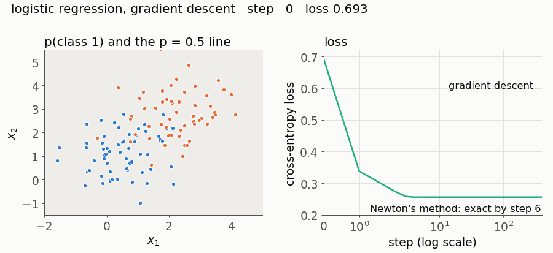

# 02 · Logistic regression

Predict the probability of a yes/no outcome, such as spam or not spam, from a weighted sum of features. This is the simplest classifier that outputs a probability, and its loss is the one neural network classifiers use.



## Intuition

Linear regression outputs any number, but a probability must lie between 0 and 1. Logistic regression computes the same weighted sum, called the *logit*, then squashes it with the S-shaped *sigmoid* function: large positive sums map near 1, large negative sums near 0, and zero maps to exactly 0.5. The points where the sum is zero form a straight line (a flat plane in more dimensions), which is the decision boundary. Training chooses the weights that make the observed labels as probable as possible. That is equivalent to minimising *cross-entropy*, a loss that punishes confident wrong answers very heavily.

## The maths

**Model.** For example $i$ with features $\mathbf{x}_i \in \mathbb{R}^d$ and label $y_i \in \{0, 1\}$:

$$z_i = \mathbf{x}_i^\top\mathbf{w} + b, \qquad p_i = \sigma(z_i) = \frac{1}{1 + e^{-z_i}}.$$

$p_i$ is the predicted probability that $y_i = 1$. Solving $p = \sigma(z)$ for $z$ gives $z = \log\frac{p}{1-p}$, the log-odds. So the model says: *the log-odds are linear in the features*.

**Derivative of the sigmoid.** Write $\sigma(z) = (1 + e^{-z})^{-1}$ and use the chain rule:

$$\sigma'(z) = \frac{e^{-z}}{(1 + e^{-z})^2} = \underbrace{\frac{1}{1 + e^{-z}}}_{\sigma(z)} \cdot \underbrace{\frac{e^{-z}}{1 + e^{-z}}}_{1 - \sigma(z)} = \sigma(z)\,\big(1 - \sigma(z)\big).$$

**Loss from likelihood.** The model gives label $y_i$ probability $p_i$ if $y_i = 1$ and $1 - p_i$ if $y_i = 0$. Both cases fit in one expression: $p_i^{y_i}(1-p_i)^{1-y_i}$. Treating examples as independent, the likelihood of all labels is the product of these. Products of many small numbers are awkward, so take the log (which turns products into sums and has the same maximiser). Then negate it and average, to get something to minimise:

$$L(\mathbf{w}, b) = -\frac{1}{n}\sum_{i=1}^{n}\Big[y_i \log p_i + (1 - y_i)\log(1 - p_i)\Big].$$

This is the *binary cross-entropy*, or *log loss*.

**The same loss in terms of $z$.** Since $\log\sigma(z) = -\log(1 + e^{-z})$ and $\log(1-\sigma(z)) = -z - \log(1 + e^{-z})$, one example's loss is

$$\ell = y\log(1+e^{-z}) + (1-y)\big(z + \log(1+e^{-z})\big) = \log(1+e^{-z}) + z - yz = \log(1+e^{z}) - yz,$$

where the last step uses $\log(1+e^{-z}) + z = \log\big(e^{z}(1+e^{-z})\big) = \log(1+e^{z})$. The code computes the loss in this form because it never evaluates $\log 0$.

**Gradient.** Differentiate $\ell = \log(1 + e^z) - yz$ with respect to $z$:

$$\frac{\partial\ell}{\partial z} = \frac{e^z}{1+e^z} - y = \sigma(z) - y = p - y.$$

Since $\partial z_i/\partial w_j = x_{ij}$ and $\partial z_i/\partial b = 1$, the chain rule gives

$$\nabla_{\mathbf{w}}L = \frac{1}{n}X^\top(\mathbf{p} - \mathbf{y}), \qquad \frac{\partial L}{\partial b} = \frac{1}{n}\sum_{i}(p_i - y_i).$$

This has the same form as linear regression's gradient (without the 2), with $\hat{y}$ replaced by $p$. But $\mathbf{p}$ depends on $\mathbf{w}$ through the sigmoid, so setting the gradient to zero gives a non-linear equation. Unlike linear regression, there is no closed-form solution, so we iterate.

**L2 penalty.** Adding $\tfrac{\lambda}{2}\lVert\mathbf{w}\rVert^2$ to the loss adds $\lambda\mathbf{w}$ to $\nabla_{\mathbf{w}}L$. The intercept is not penalised. scikit-learn minimises $\tfrac12\lVert\mathbf{w}\rVert^2 + C\sum_i \ell_i$. Divide that by $nC$ and you get our loss with $\lambda = 1/(nC)$, so the two give identical weights. Concept 03 covers what the penalty does.

**Hessian, and why the loss is convex.** Let $A = [X \mid \mathbf{1}]$ and $\boldsymbol\theta = (\mathbf{w}, b)$, so $\nabla L = \tfrac1n A^\top(\mathbf{p} - \mathbf{y})$. Differentiate once more. Using $\partial p_i/\partial\theta_k = p_i(1-p_i)\,a_{ik}$ (sigmoid derivative and chain rule):

$$H = \frac{1}{n}A^\top S A, \qquad S = \operatorname{diag}\big(p_1(1-p_1), \dots, p_n(1-p_n)\big),$$

plus $\lambda$ on the diagonal entries for $\mathbf{w}$. For any vector $\mathbf{v}$, $\mathbf{v}^\top H\mathbf{v} = \tfrac1n\sum_i p_i(1-p_i)(\mathbf{a}_i^\top\mathbf{v})^2 \ge 0$, so the loss curves upward in every direction: it is convex, and any minimum gradient descent finds is the global one.

**Newton's method.** Approximate the loss near the current $\boldsymbol\theta$ by its second-order Taylor expansion, $L(\boldsymbol\theta + \boldsymbol\Delta) \approx L + \mathbf{g}^\top\boldsymbol\Delta + \tfrac12\boldsymbol\Delta^\top H\boldsymbol\Delta$. Setting the derivative with respect to $\boldsymbol\Delta$ to zero gives $\mathbf{g} + H\boldsymbol\Delta = \mathbf{0}$, so jump straight to that quadratic's minimum:

$$\boldsymbol\theta \leftarrow \boldsymbol\theta - H^{-1}\mathbf{g}.$$

Near the answer, the error roughly squares at each step: $10^{-2}$, then $10^{-4}$, then $10^{-8}$. That is why Newton finishes in 6 steps while gradient descent is still visibly short after 400. The price is solving a $(d+1)\times(d+1)$ linear system per step, which is too expensive when $d$ is in the millions.

## Code walkthrough

| Equation | Code | Lines |
|---|---|---|
| $\sigma(z) = 1/(1+e^{-z})$, two forms so `exp` never overflows | `1 / (1 + np.exp(-z[pos]))` and `ez / (1 + ez)` | [18-20](model.py#L18-L20) |
| $L = \frac1n\sum[\log(1+e^{z_i}) - y_iz_i] + \frac\lambda2\lVert\mathbf{w}\rVert^2$ | `np.mean(np.logaddexp(0, z) - y * z) + 0.5 * lam * w @ w` | [31](model.py#L31) |
| $\mathbf{p} - \mathbf{y}$ | `error = sigmoid(X @ w + b) - y` | [36](model.py#L36) |
| $\nabla_{\mathbf{w}}L = \frac1n X^\top(\mathbf{p}-\mathbf{y}) + \lambda\mathbf{w}$ | `grad_w = X.T @ error / n + lam * w` | [37](model.py#L37) |
| $\partial L/\partial b = \frac1n\sum(p_i - y_i)$ | `grad_b = error.mean()` | [38](model.py#L38) |
| $S_{ii} = p_i(1-p_i)$ | `s = p * (1 - p)` | [46](model.py#L46) |
| $H = \frac1n A^\top S A + \lambda I_{\mathbf{w}}$ | `(A.T * s) @ A / len(X)` and the line after | [47-48](model.py#L47-L48) |
| gradient descent step | `w = w - self.learning_rate * grad_w` | [70-71](model.py#L70-L71) |
| Newton step $\boldsymbol\theta \leftarrow \boldsymbol\theta - H^{-1}\mathbf{g}$ | `np.linalg.solve(hessian(...), np.append(grad_w, grad_b))` | [74](model.py#L74) |
| predict 1 if $p \ge$ threshold | `self.predict_proba(X) >= threshold` | [89](model.py#L89) |

`np.logaddexp(0, z)` computes $\log(e^0 + e^z) = \log(1 + e^z)$ without overflow. `(A.T * s) @ A` scales column $i$ of $A^\top$ by $s_i$, which equals $A^\top S A$ without building the $n\times n$ matrix $S$. `np.linalg.solve` is used instead of inverting $H$, because solving the system directly is faster and more accurate.

The tests check Newton's method against scikit-learn's `newton-cg` solver for three penalty strengths (to `1e-10`), gradient descent against Newton's method (to `1e-10`), and the loss, gradient and full Hessian against PyTorch autograd (to `1e-10`).

## Where it breaks

**1. Perfectly separable data: the weights grow forever.** If a line separates the classes with no mistakes, making the weights larger always makes every $p_i$ closer to its label, so the loss keeps falling towards 0 and there is no minimum to converge to. Even a small L2 penalty restores one.

```python
import numpy as np
from model import LogisticRegression

rng = np.random.default_rng(0)
X = np.vstack([rng.normal(-2, 0.5, (50, 2)), rng.normal(2, 0.5, (50, 2))])
y = np.r_[np.zeros(50), np.ones(50)]

norms = [np.linalg.norm(LogisticRegression(learning_rate=1.0, n_iters=k).fit(X, y).coef_)
         for k in (100, 1000, 10_000)]
print(norms)                          # [2.56, 3.57, 4.70]: about +1.1 per tenfold more steps
assert norms[0] < norms[1] < norms[2]

ridge = LogisticRegression(lam=0.01, learning_rate=1.0, n_iters=10_000).fit(X, y)
print(np.linalg.norm(ridge.coef_))    # 1.89 and stays there
assert np.linalg.norm(ridge.coef_) < 2
```

**2. A curved boundary.** The decision boundary is always a straight line in the features you give it. On two concentric rings, accuracy is a coin toss. Adding $x_1^2$ and $x_2^2$ as features makes the problem linear in the new features, and accuracy reaches 100%.

```python
import numpy as np
from model import LogisticRegression
from sklearn.datasets import make_circles

X, y = make_circles(400, noise=0.05, factor=0.5, random_state=0)
plain = LogisticRegression(method="newton", n_iters=20).fit(X, y)
print((plain.predict(X) == y).mean())                         # 0.505

X_sq = np.column_stack([X, X**2])
squared = LogisticRegression(method="newton", n_iters=30).fit(X_sq, y)
print((squared.predict(X_sq) == y).mean())                    # 1.0
assert (plain.predict(X) == y).mean() < 0.55 and (squared.predict(X_sq) == y).mean() == 1.0
```

**3. Rare positives with a 0.5 threshold: 97.4% accuracy, zero detections.** With 2.6% positives and a weak signal, no example's predicted probability reaches 0.5 (the largest is 0.30). So the model never predicts the positive class, yet its accuracy looks excellent. The probabilities are still useful: thresholding at the base rate finds 71% of positives.

```python
import numpy as np
from model import LogisticRegression

rng = np.random.default_rng(0)
y = (rng.random(2000) < 0.02).astype(float)                   # about 2% positives
X = rng.normal(size=(2000, 1)) + y[:, None]                   # positives shifted by one std

model = LogisticRegression(method="newton", n_iters=20).fit(X, y)
pred = model.predict(X)
print((pred == y).mean(), pred[y == 1].mean())                # 0.974 accuracy, 0.0 recall
assert pred.sum() == 0 and model.predict_proba(X).max() < 0.5

pred_low = model.predict(X, threshold=y.mean())
print(pred_low[y == 1].mean())                                # 0.71 recall
assert pred_low[y == 1].mean() > 0.7
```

**4. Squared error instead of cross-entropy: confidently wrong examples stop learning.** With loss $(p - y)^2$, the gradient with respect to $z$ is $2(p-y)\,p(1-p)$. When the model is confidently wrong ($y = 1$ but $z = -10$, so $p \approx 0.00005$) the factor $p(1-p)$ almost kills it. Cross-entropy's gradient is $p - y$, so the most wrong examples get the largest push.

```python
import numpy as np
from model import sigmoid

z, y = np.array([-10.0]), 1.0
p = sigmoid(z)
grad_ce = p - y                          # cross-entropy: dl/dz
grad_mse = 2 * (p - y) * p * (1 - p)     # squared error: dl/dz
print(grad_ce, grad_mse)                 # [-0.99995]  [-9.1e-05]: 11,000 times smaller
assert abs(grad_ce[0] / grad_mse[0]) > 10_000
```

## Common mistakes

- **"Logistic regression is a regression method."** It is a classifier. The name comes from fitting a linear model to the log-odds (the *logit*).
- **"A coefficient is the change in probability per unit of the feature."** It is the change in *log-odds*. Probability changes non-linearly: the same step in $z$ moves $p$ a lot near 0.5 and hardly at all near 0 or 1. $e^{w_j}$ is the factor by which the odds multiply per unit increase in $x_j$.
- **"The 0.5 threshold is part of the model."** The model outputs probabilities; the threshold is a separate decision. Pick it from the costs of each kind of mistake, as example 3 shows.
- **"Gradient descent might find a bad local minimum."** The Hessian derivation shows the loss is convex, so any minimum is the global one. The real risks are slow convergence and, on separable data, no minimum at all.
- **"The predicted probabilities are trustworthy because they are between 0 and 1."** They are calibrated only if the log-odds really are close to linear in the features. A strong L2 penalty also pulls every probability towards the overall rate of positives.

## Further reading

- Cox, "The regression analysis of binary sequences", *Journal of the Royal Statistical Society, Series B* 20(2) (1958): the paper that introduced logistic regression as it is used today.
- Hastie, Tibshirani and Friedman, *The Elements of Statistical Learning*, 2nd edition (2009), section 4.4: logistic regression and Newton's method (iteratively reweighted least squares).
- Bishop, *Pattern Recognition and Machine Learning* (2006), section 4.3: the probabilistic derivation and the Hessian.
- Murphy, *Machine Learning: A Probabilistic Perspective* (2012), chapter 8: logistic regression and its optimisation methods.
- Nocedal and Wright, *Numerical Optimization*, 2nd edition (2006), chapters 2-3: why Newton's method converges quadratically.
