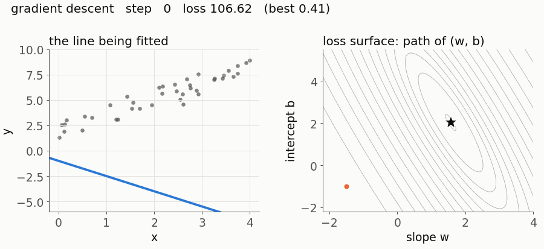

# one-file-ml

Every core ML algorithm in one readable NumPy file, with an animation of it learning and an honest section on where it breaks.



**Work in progress.** Twelve concepts are planned. Each one has a NumPy-only implementation under 150 lines, tests against scikit-learn or PyTorch, an animation, and a README covering the maths, the code, and where it fails.

| # | Concept | Status |
|---|---|---|
| 01 | [Linear regression and gradient descent](01-linear-regression/) | done |
| 02-12 | Logistic regression to a transformer block | in progress |

```bash
python3.11 -m venv .venv && source .venv/bin/activate
pip install -r requirements.txt
make test
```

MIT licence.
