# one-file-ml

[](https://github.com/ayush-jha-ai/one-file-ml/actions/workflows/ci.yml)
[](LICENSE)

<table>
<tr>
<td><a href="01-linear-regression/"></a></td>
<td><a href="02-logistic-regression/">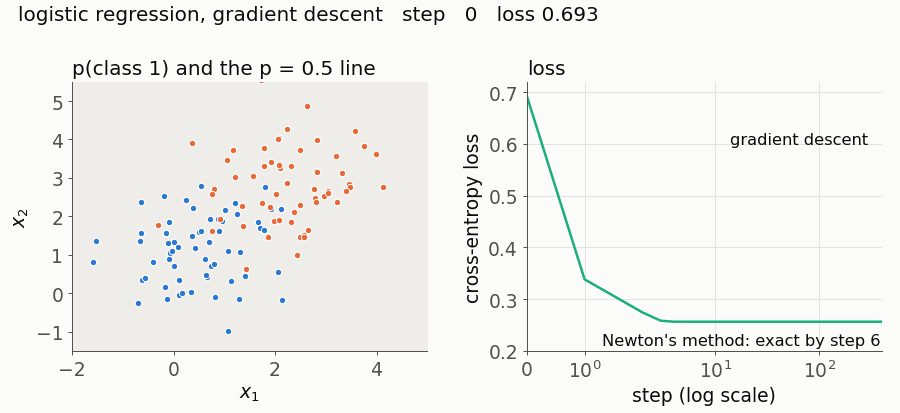</a></td>
<td><a href="03-regularisation/">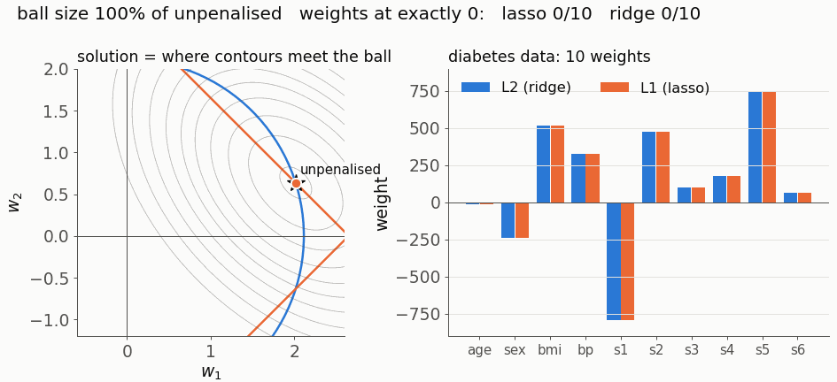</a></td>
</tr>
<tr>
<td><a href="04-bias-variance/">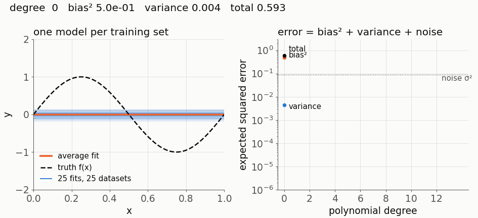</a></td>
<td><a href="05-knn/">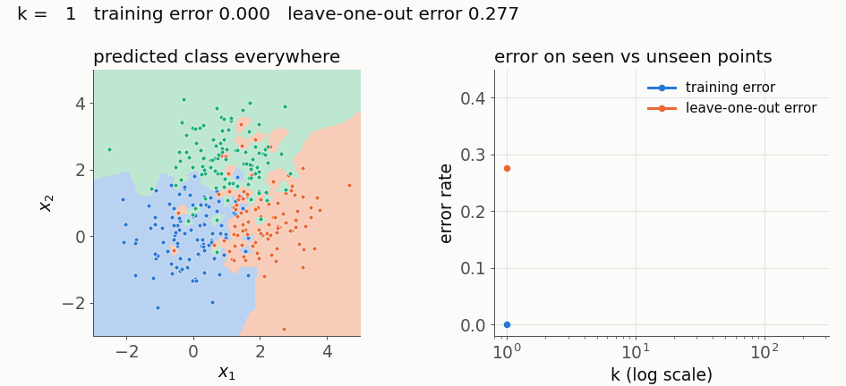</a></td>
<td><a href="06-kmeans/">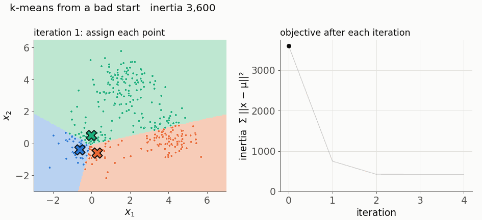</a></td>
</tr>
<tr>
<td><a href="07-pca/">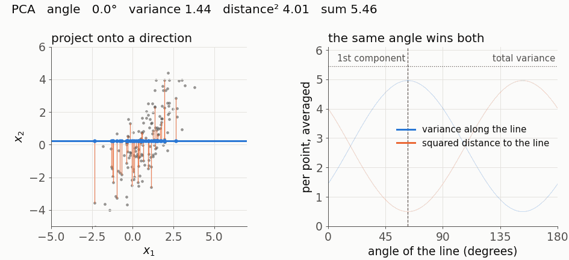</a></td>
<td><a href="08-decision-trees/">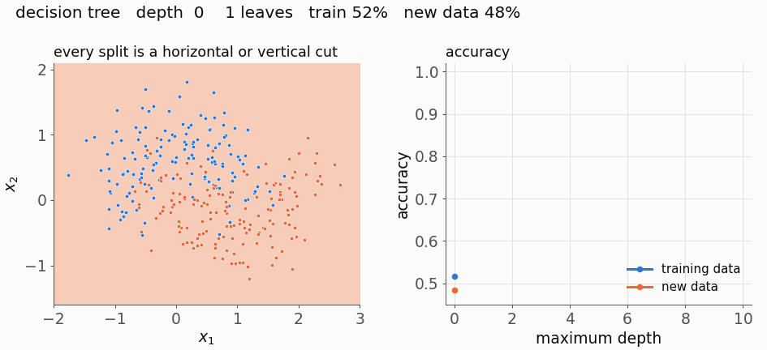</a></td>
<td><a href="09-random-forests/">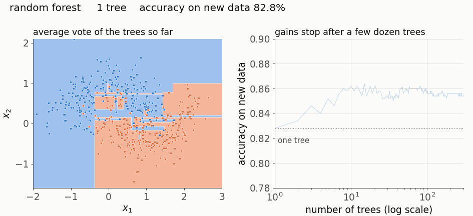</a></td>
</tr>
<tr>
<td><a href="10-gradient-boosting/">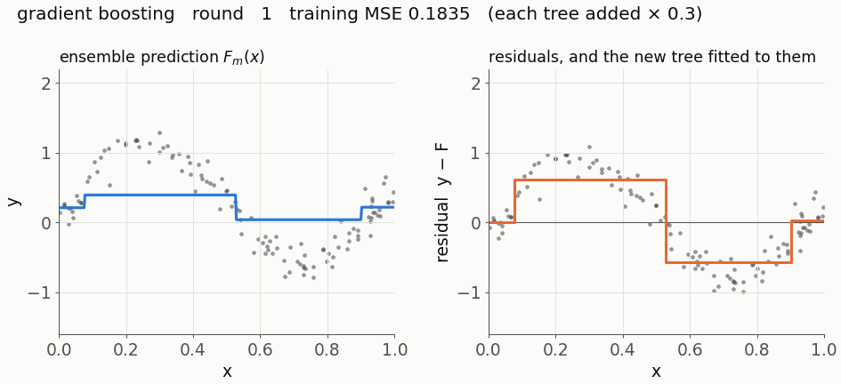</a></td>
<td><a href="11-neural-networks/">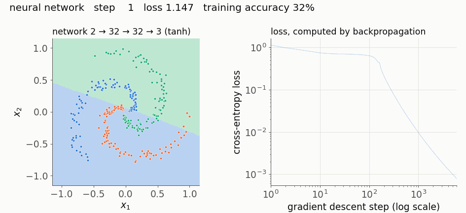</a></td>
<td><a href="12-attention/">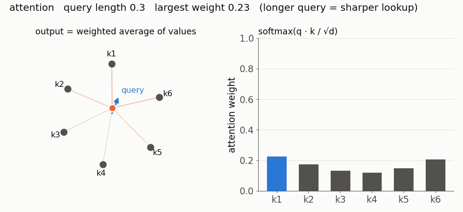</a></td>
</tr>
</table>

**Every core ML algorithm in one readable NumPy file, with an animation of it learning and an honest section on where it breaks.**

## The concepts

| # | Concept | What you will understand | Level |
|---|---|---|---|
| 01 | [Linear regression and gradient descent](01-linear-regression/) | Fitting by gradient descent, and the exact learning rate at which it diverges | Beginner |
| 02 | [Logistic regression](02-logistic-regression/) | Turning a weighted sum into a probability, and why Newton's method needs 6 steps where gradient descent needs hundreds | Beginner |
| 03 | [Regularisation: L1 versus L2](03-regularisation/) | Why L1 sets weights to exactly zero and L2 never does | Intermediate |
| 04 | [The bias-variance trade-off](04-bias-variance/) | Splitting error into bias, variance and noise, exactly, and where the U-curve fails | Intermediate |
| 05 | [k-nearest neighbours](05-knn/) | Prediction by similarity, and why distance stops meaning anything in high dimensions | Beginner |
| 06 | [k-means clustering](06-kmeans/) | Two alternating steps that each lower one objective, and how they get stuck | Beginner |
| 07 | [Principal component analysis](07-pca/) | Why maximum variance and minimum reconstruction error are the same direction | Intermediate |
| 08 | [Decision trees](08-decision-trees/) | Greedy splitting by impurity, and the interactions it cannot see | Intermediate |
| 09 | [Random forests](09-random-forests/) | Why averaging correlated trees helps, and the floor it cannot get below | Intermediate |
| 10 | [Gradient boosting](10-gradient-boosting/) | Fitting each tree to the negative gradient, and when to stop | Advanced |
| 11 | [Neural networks and backpropagation](11-neural-networks/) | The chain rule as code, first one number at a time, then for whole layers | Advanced |
| 12 | [Attention and a transformer block](12-attention/) | Attention as a soft lookup, and every part of a transformer block | Advanced |

Each folder contains the same five files:

- `model.py`: the algorithm in NumPy only, under 150 lines, readable top to bottom.
- `test_model.py`: checks against scikit-learn or PyTorch, with every tolerance written down.
- `animate.py`: generates `demo.gif`.
- `README.md`: intuition, the maths step by step, a table mapping each equation to the line of code that implements it, 2 to 4 failure modes you can run, common misconceptions, and further reading.

## How to use this repo

```bash
git clone https://github.com/ayush-jha-ai/one-file-ml.git
cd one-file-ml
python3.11 -m venv .venv && source .venv/bin/activate
pip install -r requirements.txt
make test        # every test, including every example in every README
make gifs        # regenerate all twelve animations
```

Open a concept's README, read the maths with `model.py` open beside it, then run the "where it breaks" examples from inside that folder and change the numbers. You need Python, school-level calculus (derivatives, the chain rule) and basic linear algebra (matrix products, transposes).

Three ways through:

- **Fastest route to neural networks.** 01 → 02 → 11 → 12. Gradient descent, then cross-entropy and the sigmoid, then backpropagation, then attention. Each one uses the previous one's maths directly.
- **Classical machine learning.** 01 → 02 → 03 → 04 → 05 → 06 → 07 → 08 → 09 → 10. Linear models and regularisation, the bias-variance framework, then distance-based methods, PCA and tree ensembles.
- **The full sequence.** 01 to 12 in order. Later concepts build on earlier ones: the trees in 09 and 10 use the same split search as 08, and the output-layer gradient in 11 is the $p - y$ derived in 02.

## How it stays correct

- **Implementations are checked against reference libraries.** Where an exact match is possible it is required, usually to `1e-10` or better:
  - concept 10 is checked against scikit-learn's gradient boosting at every one of 100 rounds;
  - concept 11 reproduces 50 steps of scikit-learn's neural network training from the same starting weights;
  - concept 12's transformer block matches PyTorch's to `1e-12`.
- **Mismatches are explained, not hidden.** Where scikit-learn breaks exact ties between splits differently, the tests walk both trees and prove that every disagreement is a tie. Random forests cannot match draw for draw, so they are compared statistically, with the tolerance justified in the test file. Tolerances are never loosened to make a test pass.
- **Every number in a README is tested.** Every code block in every README runs in CI. Each "where it breaks" example ends in assertions, so if a claimed number stops being true, the build fails.
- **The walkthrough tables are checked.** A repository test confirms that each equation's line link points at the code it quotes. It also checks that `model.py` imports only NumPy and stays under 150 lines, and that each GIF stays under 3 MB and 8 seconds.
- **Everything is deterministic.** Seeds are fixed, so re-running `make gifs` produces byte-identical animations.

## Why this exists

Most from-scratch ML material sits at one of two extremes. Either the maths stops before the code, or the code hides the maths inside library calls. The middle is where understanding happens: being able to point at line 21 and say which derivative it computes. This repo tries to be that middle for the twelve ideas that most of machine learning is built from, with each derivation written out in full and each claim tested. Its "where it breaks" sections show the cases where each method fails, because knowing those is what separates using a method from understanding it.

## Contributing

New concepts, extra failure-mode examples and translations are welcome. [CONTRIBUTING.md](CONTRIBUTING.md) has the exact template and the checks a concept must pass, and [ISSUES.md](ISSUES.md) lists good first issues.

MIT licence. See [LICENSE](LICENSE).
